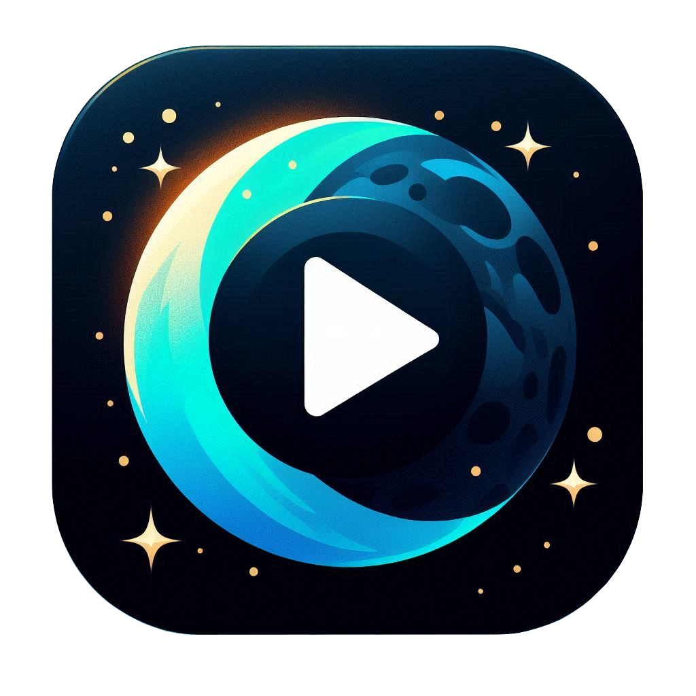

[](https://central.sonatype.com/artifact/io.github.darkryh.moongetter/moongetter-core)

# MoonGetter for Kotlin

[](https://play.google.com/store/apps/details?id=com.ead.project.moongetter)
[](https://play.google.com/store/apps/details?id=com.ead.project.moongetter)

**MoonGetter** is a Kotlin Multiplatform library for resolving video-hosting links into playback requests. Use the built-in server bundle or register your own providers, then pass the returned URL, method, and headers to your player.

## ✅ Features

- Custom server factories with portable URL matching.
- Suspend APIs for coroutine-based extraction.
- HTTP client injection through Ktor or the JVM/Android OkHttp adapter.
- Configurable cookies, headers, and request timeouts.
- Android, JVM, and iOS samples with shared Compose code.

## 🔄 Platform support

| Platform | Support |
| --- | --- |
| Android | Supported; sample requires API 26+ |
| JVM / desktop | Supported; Java 21 toolchain |
| iOS devices | ARM64 (`iosArm64`) |
| iOS simulators | Apple Silicon (`iosSimulatorArm64`) |

Intel iOS simulators (`iosX64`) are no longer supported. The libraries and iOS sample use the same ARM64 targets. See [sample setup](sample/README.md) for platform requirements.

<a id="providers"></a>

## 🌐 Supported servers

The regular `serverBundle` includes these provider implementations. Availability depends on the video, host, network, and verification requirements.

- ✅ 1CloudFile
- ✅ Abyss
- ⚠️ Doodstream — verification can block extraction
- ✅ Facebook
- ✅ FileMoon / Byse
- ✅ Fireload
- ✅ Google Drive
- ✅ Hexload
- ✅ LaMovie
- ✅ Lulustream
- ✅ Mail.ru
- ✅ MediaFire
- ✅ MEGA
- ✅ Mixdrop
- ✅ Mp4Upload
- ✅ OK.ru
- ✅ Pixeldrain
- ✅ RPMStream
- ✅ Savefiles
- ✅ Sendvid
- ✅ Streamtape
- ✅ Streamwish
- ✅ Uqload
- ✅ Vihide
- ✅ Vimeos
- ✅ VK
- ✅ VOE
- ✅ X/Twitter
- ✅ YourUpload

### Experimental

- ⚠️ GoFile
- ⚠️ 1fichier

Guest access restrictions and rate limits can prevent these extractors from returning a source.

### Deprecated

- 💥 GoodStream
- 💥 Vidguard

Deprecated implementations and factories are retained. VOE and Fireload are supported. The Robot/WebView API and its modules have been removed.

## ☕ Installation (Gradle)

```kotlin
repositories {
    mavenCentral()
}
```

The badge shows the latest published Maven version. This checkout prepares **`2.0.0-beta01`**; use that version after it is published. Keep all MoonGetter artifacts on the same version. See the [beta migration notes](CHANGELOG.md) for breaking changes.

### Kotlin Multiplatform dependencies

Add these dependencies to your existing Kotlin Multiplatform module. Configure `iosArm64()` and `iosSimulatorArm64()` for iOS; use `jvmMain` for your JVM target.

```kotlin
val moonGetterVersion = "2.0.0-beta01"
val ktorVersion = "3.6.0"

kotlin {
    sourceSets {
        commonMain.dependencies {
            implementation("io.github.darkryh.moongetter:moongetter-core:$moonGetterVersion")
            implementation("io.github.darkryh.moongetter:moongetter-client-ktor:$moonGetterVersion")
            implementation("io.github.darkryh.moongetter:moongetter-server-bundle:$moonGetterVersion")
        }
        androidMain.dependencies {
            implementation("io.ktor:ktor-client-okhttp:$ktorVersion")
            implementation("io.github.darkryh.moongetter:moongetter-client-cookie-java-net:$moonGetterVersion")
        }
        jvmMain.dependencies {
            implementation("io.ktor:ktor-client-okhttp:$ktorVersion")
            implementation("io.github.darkryh.moongetter:moongetter-client-cookie-java-net:$moonGetterVersion")
        }
        iosMain.dependencies {
            implementation("io.ktor:ktor-client-darwin:$ktorVersion")
        }
    }
}
```

To register only selected providers, replace `moongetter-server-bundle` with the corresponding modules, such as `moongetter-abyss`, and pass their factories to `Engine.Builder().onCore(...)`.

### Kotlin JVM / Android dependencies

For a project without multiplatform source sets:

```kotlin
val moonGetterVersion = "2.0.0-beta01"

dependencies {
    implementation("io.github.darkryh.moongetter:moongetter-core:$moonGetterVersion")
    implementation("io.github.darkryh.moongetter:moongetter-server-bundle:$moonGetterVersion")
    implementation("io.github.darkryh.moongetter:moongetter-client-ktor:$moonGetterVersion")
    implementation("io.github.darkryh.moongetter:moongetter-client-cookie-java-net:$moonGetterVersion")
    implementation("io.ktor:ktor-client-okhttp:3.6.0")
}
```

## 🧐 Client and cookie integration

`KtorMoonClient` takes a platform engine, cookie storage, and trust manager. Use persistent cookie storage for providers that establish a session. The empty trust-manager adapter below leaves the platform engine’s normal certificate validation in place.

Android/JVM client:

```kotlin
import com.ead.lib.moongetter.client.MoonClient
import com.ead.lib.moongetter.client.cookie.java.net.JavaNetCookieManagement
import com.ead.lib.moongetter.client.ktor.KtorMoonClient
import com.ead.lib.moongetter.client.trust.manager.MoonTrust
import io.ktor.client.engine.okhttp.OkHttp

fun createJvmClient(): MoonClient = KtorMoonClient(
    engineFactory = OkHttp,
    cookieManagement = JavaNetCookieManagement(),
    trustManager = MoonTrust.Manager.newEmptyFactory(),
)
```

iOS client, placed in `iosMain`:

```kotlin
import com.ead.lib.moongetter.client.MoonClient
import com.ead.lib.moongetter.client.cookie.managment.IosCookieManagement
import com.ead.lib.moongetter.client.ktor.KtorMoonClient
import com.ead.lib.moongetter.client.trust.manager.MoonTrust
import io.ktor.client.engine.darwin.Darwin

fun createIosClient(): MoonClient = KtorMoonClient(
    engineFactory = Darwin,
    cookieManagement = IosCookieManagement(),
    trustManager = MoonTrust.Manager.newEmptyFactory(),
)
```

The JVM/Android-only `moongetter-client-okhttp` module is an alternative to `KtorMoonClient`; its `com.ead.lib.moongetter.client.okhttp.OkHttpClient` singleton includes cookie handling. Ktor supports all listed platforms.

## 🚀 Example usage

Initialize once at application startup with your platform client. Reuse it for subsequent requests.

```kotlin
import com.ead.lib.moongetter.MoonFactory
import com.ead.lib.moongetter.MoonGetter
import com.ead.lib.moongetter.client.MoonClient
import com.ead.lib.moongetter.models.builder.Engine
import com.ead.lib.moongetter.server.bundle.serverBundle

fun initializeMoonGetter(client: MoonClient) {
    MoonGetter.start(
        MoonFactory.Builder()
            .setClient(client)
            .setTimeout(60_000L)
            .setEngine(Engine.Builder().onCore(serverBundle).build())
    )
}
```

For example, call `initializeMoonGetter(createJvmClient())` on Android/JVM or `initializeMoonGetter(createIosClient())` on iOS. Resolve links from a coroutine:

```kotlin
import com.ead.lib.moongetter.MoonGetter
import com.ead.lib.moongetter.models.Video
import com.ead.lib.moongetter.models.exceptions.InvalidServerException

suspend fun loadVideos(url: String): List<Video> {
    return try {
        MoonGetter.get(url).videos
    } catch (failure: InvalidServerException) {
        // Present the provider error to the caller or UI.
        throw failure
    }
}
```

Each `Video` contains its quality and a `request` with `url`, `method`, and `headers`. Preserve the headers when configuring playback. Use `get` to inspect failures; nullable variants return `null` when resolution fails. Let coroutine cancellation propagate. The [sample ViewModel](sample/shared/src/commonMain/kotlin/com/ead/project/moongetter/presentation/main/MainViewModel.kt) shows loading, errors, cancellation, and playlist cleanup.

MEGA and Abyss return device-local playback URLs. Keep those sessions alive while playing, then release each URL with `MegaProxy.release(url)` or `AbyssProxy.release(url)`. See their [MEGA](server-src/moongetter-mega/README.md) and [Abyss](server-src/moongetter-abyss/README.md) lifecycle guides.

### Server retrieval API

Initialize MoonGetter before calling these methods.

| API | Result |
| --- | --- |
| `identifier(url)` | Matching provider name, without extraction |
| `get(url)` | Resolved `Server`, or an exception |
| `getOrNull(url)` | Resolved `Server`, or `null` |
| `get(urls)` | Successfully resolved servers; experimental API |
| `getUntilFindResource(urls)` | First successfully resolved server |
| `getUntilFindResourceOrNull(urls)` | First successfully resolved server, or `null` |

The batch `get(urls)` overload requires opting in to `ExperimentalFeature`; it can skip failed URLs. Use the single-URL API when each failure needs to be reported.

## 🛠 Add your own server

Implement `Server` and register a `Server.Factory`. This template expects a page with an HTTPS `<source src="...">` entry; adapt its parsing to your site.

```kotlin
import com.ead.lib.moongetter.client.MoonClient
import com.ead.lib.moongetter.client.models.Configuration
import com.ead.lib.moongetter.models.Server
import com.ead.lib.moongetter.models.Video
import com.ead.lib.moongetter.models.error.Error
import com.ead.lib.moongetter.models.exceptions.InvalidServerException

class CustomServer(
    url: String,
    client: MoonClient,
    headers: HashMap<String, String>,
    configData: Configuration.Data,
) : Server(url, client, headers, configData) {
    override suspend fun onExtract(): List<Video> {
        val response = client.GET()
        if (!response.isSuccess) {
            throw InvalidServerException(
                "Custom server request failed",
                Error.UNSUCCESSFUL_RESPONSE,
                response.statusCode,
            )
        }
        val source = Regex(
            """<source\s+src=["'](https://[^"']+)["']""",
            RegexOption.IGNORE_CASE,
        ).find(response.body.asString())?.groupValues?.get(1)
            ?: throw InvalidServerException(
                "Custom server source not found",
                Error.EXPECTED_RESPONSE_NOT_FOUND,
            )
        return listOf(Video(url = source, headers = headers + ("Referer" to url)))
    }
}

object CustomServerFactory : Server.Factory {
    override val serverName = "CustomServer"
    override val pattern = """^https://video\.example\.com/embed/[A-Za-z0-9]+$"""

    override fun create(
        url: String,
        headers: HashMap<String, String>,
        configData: Configuration.Data,
        client: MoonClient,
    ): Server = CustomServer(url, client, headers, configData)
}
```

Add the factory to your engine:

```kotlin
import com.ead.lib.moongetter.models.Server
import com.ead.lib.moongetter.models.builder.Engine
import com.ead.lib.moongetter.server.bundle.serverBundle

fun customEngine(): Engine = Engine.Builder()
    .onCore(arrayOf<Server.Factory>(CustomServerFactory) + serverBundle)
    .build()
```

Pass this engine to `.setEngine(...)` during initialization. Match only the URLs your provider handles; factories are instantiated through `create`, without reflection.

## 🧪 Run the samples

```shell
./gradlew :sample:androidApp:installDebug
./gradlew :sample:desktopApp:run
open sample/iosApp/iosApp.xcodeproj
```

The shared UI lives in `sample/shared`. Select the `iosApp` scheme in Xcode and configure your signing team for a physical device. Desktop sample playback requires native VLC. See [sample setup](sample/README.md) for configuration and [validation notes](docs/validation/dependencies.md) for build checks.

## 🤝 Contributing

Open an issue or pull request, or contact [@Darkryh on X / Twitter](https://x.com/Darkryh).

## License

[MIT](LICENSE).
